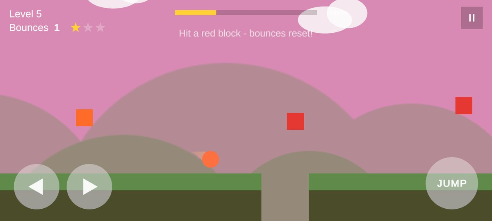
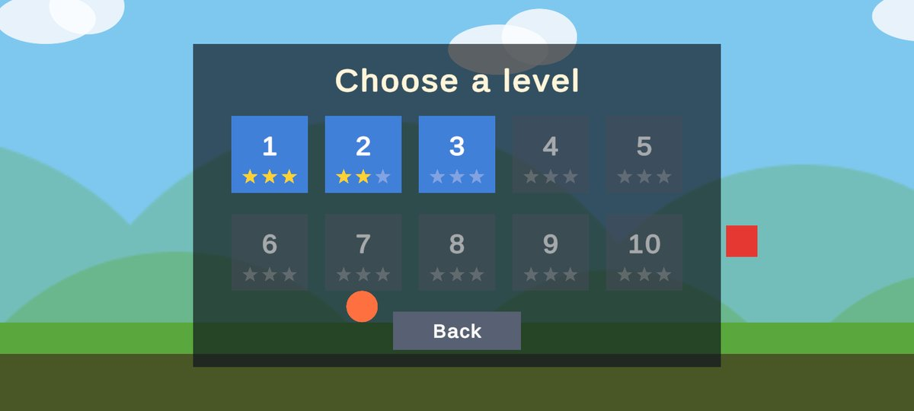

# Bouncing Orb

A 2D physics platformer made in Unity. Roll and jump your orb to the finish flag: every bounce on the ground scores a point, but touching a red block resets your bounces to zero. There are **10 levels** with stars to earn, pits to jump and moving blocks to dodge.

**▶ Download for Android:** [latest release](https://github.com/MAHESH21723/The-Bouncing-Orb/releases/latest) (APK)

  



## How to play

| | Keyboard | Phone |
|---|---|---|
| Roll | A / D or ← / → | ◀ ▶ buttons |
| Jump | Space, W or ↑ | JUMP button |
| Pause | Esc | II button (or the Back button) |

- **Reach the flag** to finish the level and unlock the next one.
- **Bounces score points.** Each real bounce on the ground is +1.
- **Red blocks reset your bounces to 0.** Orange blocks do the same, and they move up and down.
- **Falling into a pit** means retrying the level.
- **Stars:** finishing gives ★. Reaching the bounce target gives ★★, and 1.5× the target gives ★★★. Your best stars per level are saved.



## Level system

| Levels | What's new |
|---|---|
| 1–2 | Short courses, high blocks: learn to bounce |
| 3–4 | **Pits** to jump over, lower blocks |
| 5–10 | **Moving blocks**, longer courses, tighter spacing, darker skies |

Each level is built from a row in [`LevelData`](Assets/Script/LevelData.cs): its length, block spacing and height, pit chance, moving-block chance, bounce target and colours. The layout is seeded, so a level is the same every time you replay it.

## Scripts

| Script | What it does |
|---|---|
| [`PlayerOrbController`](Assets/Script/PlayerOrbController.cs) | Rolling with force and speed clamp, ground check and a buffered jump; keyboard and touch input |
| [`OrbCollisionHandler`](Assets/Script/OrbCollisionHandler.cs) | +1 per real bounce on the ground; red blocks reset the score; bounce sound |
| [`ScoreManager`](Assets/Script/ScoreManager.cs) | Holds the score and tells the interface when it changes |
| [`LevelData`](Assets/Script/LevelData.cs) | The settings for the 10 levels |
| [`LevelBuilder`](Assets/Script/LevelBuilder.cs) | Builds the ground, pits, blocks, finish flag, hills and clouds |
| [`MovingObstacle`](Assets/Script/MovingObstacle.cs) | Moves a block up and down |
| [`CameraFollow`](Assets/Script/CameraFollow.cs) | Smooth side-scrolling camera |
| [`GameManager`](Assets/Script/GameManager.cs) | Title, level select, HUD, pause, complete/failed screens, stars and saved progress, touch buttons |
| [`UIKit`](Assets/Script/UIKit.cs) | Small helpers that build the interface from code |

The first version (an assessment task) had an endless road and randomly spawned blocks, made with `RoadSpawner` and `RandomObstacleSpawner`. Those are kept in the git history. The level builder replaced them.

## Run it yourself

1. Open the project in **Unity 6 (6000.6)** with the Android module installed.
2. Open `Assets/Scenes/SampleScene.unity` and press **Play**.
3. To build the APK, use **Bouncing Orb → Build Android APK**, or run it headless:
   ```
   Unity.exe -batchmode -quit -projectPath . -buildTarget Android -executeMethod AndroidBuild.Build
   ```
   The APK goes to `Builds/BouncingOrb.apk`.

## Credits

- **Game, code and art:** Maheshwaran. The sprites are Unity's built-in 2D shapes, and the app icon was drawn for this project.
- **Bounce sound:** `blendertimer-bounce-8111` from [Pixabay](https://pixabay.com/sound-effects/), used under the Pixabay Content License.
- **Font:** Liberation Sans (SIL Open Font License), bundled with TextMesh Pro.

## Author

**Maheshwaran**: [kmaheshwaran9965@gmail.com](mailto:kmaheshwaran9965@gmail.com) · [github.com/MAHESH21723](https://github.com/MAHESH21723)
